

  <a href="https://aaronzajicek.com"></a>

  
  
  
  
  

## AI and automation

I'm Aaron, an AI-focused builder and software engineer in Katy, Texas. I run [Byte-Sized Wisdom](https://byte-sizedwisdom.com), a consulting studio where I fold large language models into real operations: agents that triage and report, automations that remove the busywork, and tools polished enough that people actually use them.

I came up through IT help desk and security tooling, where a broken thing has to be fixed now. That is why I build systems to be reliable before they are clever.

  

 

<table>
  <tr>
    <td width="33%" valign="top">
      <h3>AI agents</h3>
      Agents and assistants that read, decide and act across your tools, with a person in the loop where it matters.
        
      <code>LLM applications</code> <code>RAG</code> <code>MCP</code> <code>Prompt engineering</code>
    </td>
    <td width="33%" valign="top">
      <h3>Workflow automation</h3>
      Pipelines that connect the apps and APIs a team already uses, so the repetitive work runs itself.
        
      <code>n8n</code> <code>Python</code> <code>APIs</code> <code>Webhooks</code>
    </td>
    <td width="33%" valign="top">
      <h3>Product engineering</h3>
      Dashboards, extensions and web apps that put the AI in front of the people who need it.
        
      <code>TypeScript</code> <code>React</code> <code>Next.js</code> <code>Node.js</code>
    </td>
  </tr>
</table>

## Side projects

What I build on nights and weekends: games, security tools and hardware.

<table>
  <tr>
    <td valign="top">
      <a href="https://glitchpong.com"></a>
      <a href="https://glitchpong.com">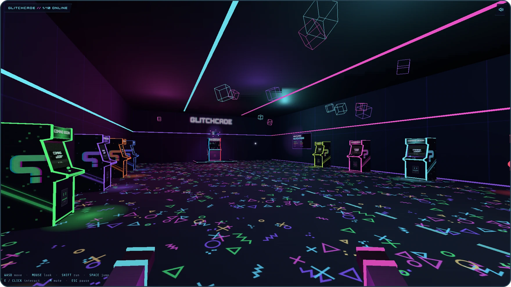</a>
        
      <b>A first-person 3D arcade that runs in the browser.</b> Walk the floor and play four finished cabinets: Glitch Pong, Breakpoint, Black-Hole Nexus and Signal Lost. There is online multiplayer, a prize counter, and a computer opponent built to play like a person: it reacts late, misjudges fast shots and can be tricked.
        
      <code>JavaScript</code> <code>three.js</code> <code>Node.js</code> <code>Socket.IO</code> <code>WebRTC</code>
        
      <a href="https://glitchpong.com"><b>Play it</b></a> &nbsp;·&nbsp; <a href="https://github.com/mrA2Z0101/Glitch-Pong-Website"><b>Code</b></a>
    </td>
  </tr>
</table>

<table>
  <tr>
    <td width="50%" valign="top">
      <a href="https://github.com/mrA2Z0101/OFF-THE-HOOK"></a>
      <a href="https://github.com/mrA2Z0101/OFF-THE-HOOK">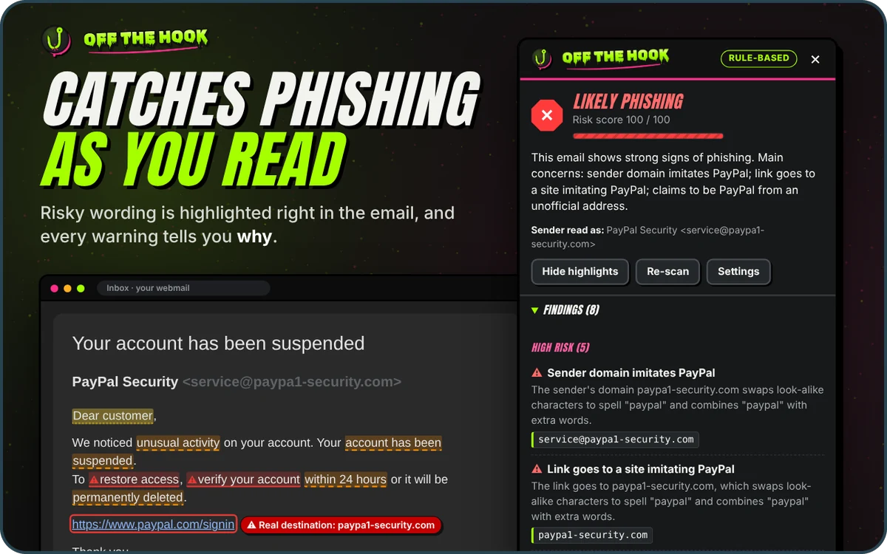</a>
        
      <b>Phishing detection that lives in your inbox.</b> It reads the email you have open in Gmail or Outlook, highlights the giveaways and explains each one. More than 55 checks run in the browser, so your email never leaves your computer. An optional AI second opinion comes from a local Ollama model, any OpenAI-compatible API, or Anthropic.
        
      <code>JavaScript</code> <code>Manifest V3</code> <code>LLM APIs</code>
        
      <a href="https://github.com/mrA2Z0101/OFF-THE-HOOK"><b>Code</b></a>
    </td>
    <td width="50%" valign="top">
      
      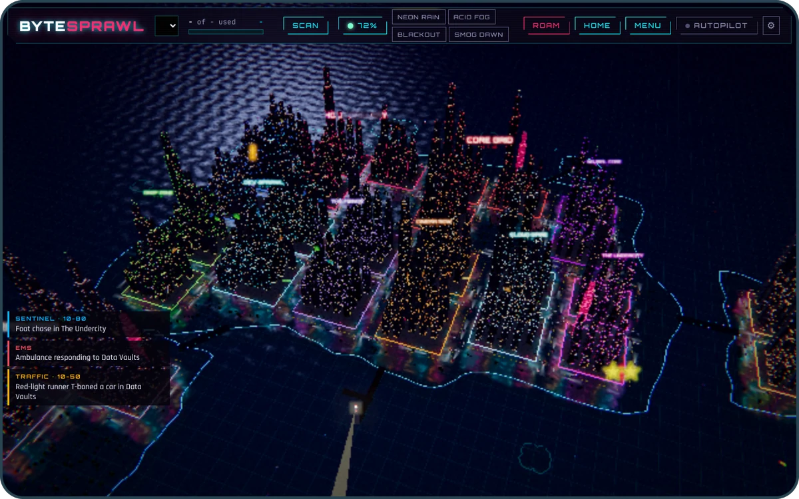
        
      <b>Your Windows disk drawn as a cyberpunk city.</b> Folders and big files become buildings you can walk and drive past, and the PC's health shapes the streets. Ask in plain English to free up space and a local Ollama model reads the request. Nothing is cleaned until you approve it.
        
      <code>Python</code> <code>three.js</code> <code>Ollama</code>
        
      Private repo for now
    </td>
  </tr>
</table>

<table>
  <tr>
    <td width="50%" valign="top">
      
      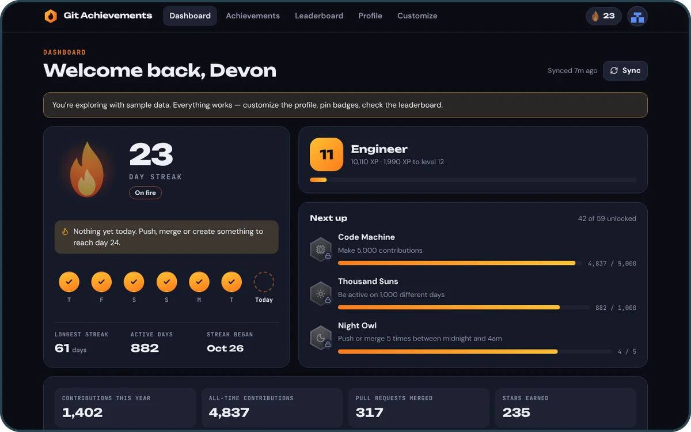
        
      <b>Streaks, achievements and custom profiles for your GitHub account.</b> 59 achievements across five rarities, XP and levels, a leaderboard, and a streak card you can drop into a README.
        
      <code>Next.js</code> <code>React</code> <code>TypeScript</code> <code>Postgres</code>
        
      Private repo for now
    </td>
    <td width="50%" valign="top">
      
      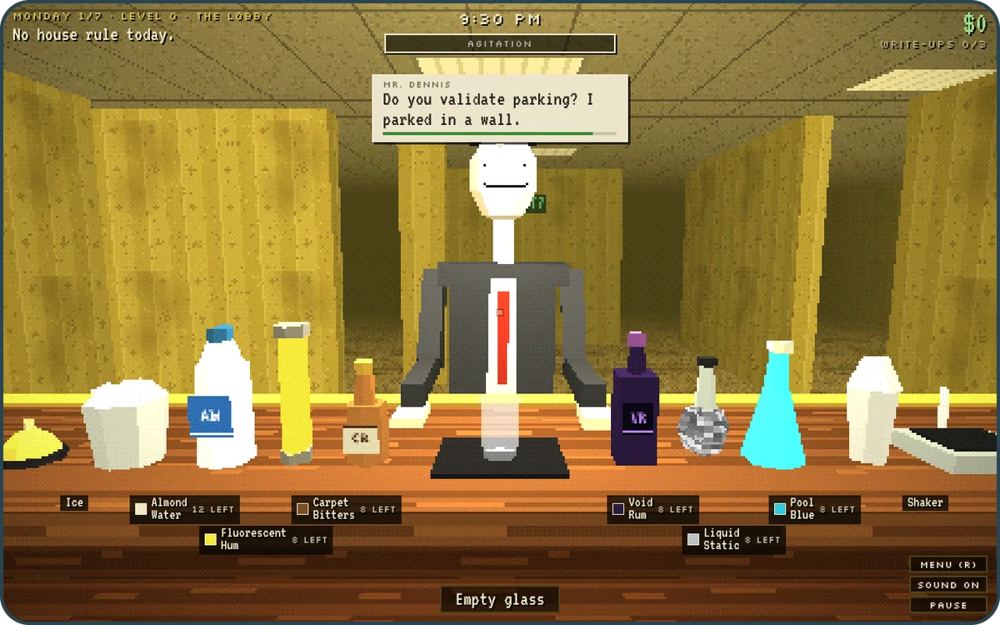
        
      <b>A first-person comedy horror bartending game set in the Backrooms.</b> The guests are not people, each of them has one rule, and so does the house. The prototype covers a seven-shift week with a debt to clear by Sunday.
        
      <code>JavaScript</code> <code>three.js</code> <code>Vite</code>
        
      Private repo for now
    </td>
  </tr>
</table>

<table>
  <tr>
    <td width="50%" valign="top">
      <a href="https://github.com/mrA2Z0101/Defendagotchi"></a>
      <a href="https://github.com/mrA2Z0101/Defendagotchi">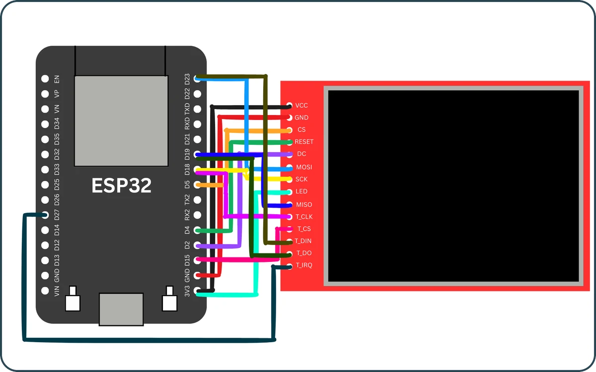</a>
        
      <b>A Tamagotchi-style Wi-Fi security companion.</b> It runs on an ESP32 with a touchscreen. Care for the pet to level it up and unlock scanners for deauth attacks, rogue access points, captive portals and weak encryption.
        
      <code>ESP32</code> <code>C++</code> <code>Arduino</code>
        
      <a href="https://github.com/mrA2Z0101/Defendagotchi"><b>Code</b></a>
    </td>
    <td width="50%" valign="top">
      <a href="https://github.com/mrA2Z0101/GhostProcess"></a>
      <a href="https://github.com/mrA2Z0101/GhostProcess">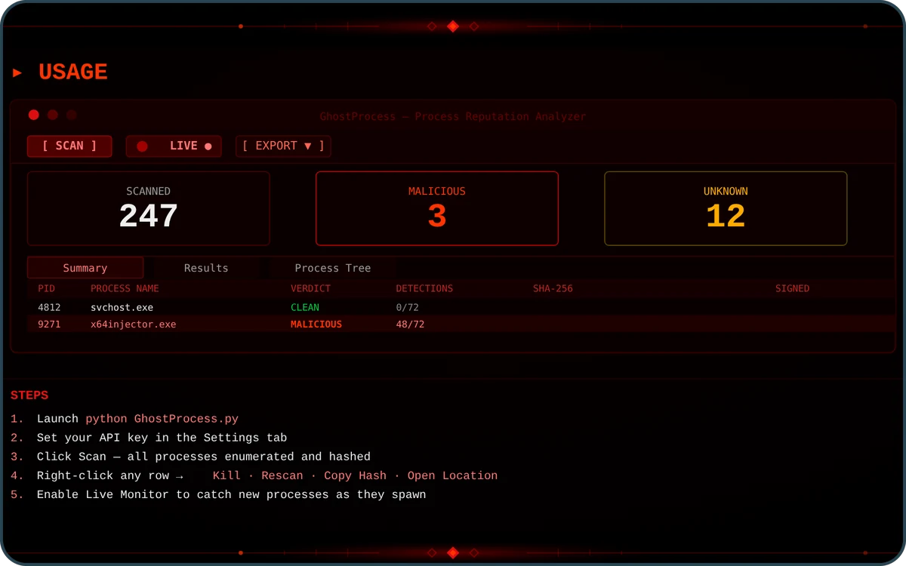</a>
        
      <b>A process scanner that hunts for malicious executables hiding in memory.</b> It hashes every running process, checks each one against threat intelligence such as VirusTotal, and lets you quarantine what it flags.
        
      <code>Python</code> <code>Tkinter</code> <code>VirusTotal</code>
        
      <a href="https://github.com/mrA2Z0101/GhostProcess"><b>Code</b></a>
    </td>
  </tr>
</table>

 

  

